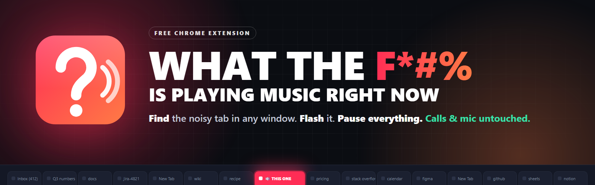
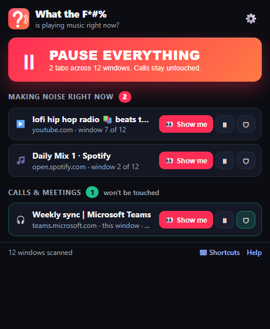
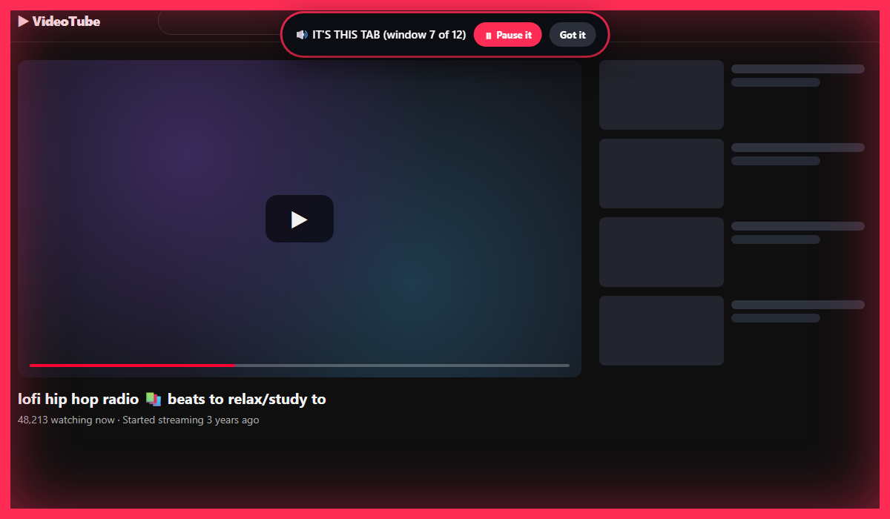

<p align="center">
  
</p>

<h1 align="center">WhatTheF*#%IsPlayingMusicRightNow</h1>

<p align="center">
  <b>A free Chrome extension for people with 12 windows and 800 tabs who just want the music to stop.</b><br>
  It finds whichever tab is making noise (in <i>any</i> window), flashes it so you can't miss it,<br>
  and gives you one big <b>PAUSE EVERYTHING</b> button that never touches your calls or your mic.
</p>

<p align="center">
  
  
  
  
  
  
</p>

---

## The problem

You pressed play on something. A song, a YouTube video, a podcast, an autoplaying ad with the volume of a jet engine.

Now you need it to stop. But you have **12 Chrome windows** open, each with **800 tabs**, and you don't remember which tab it was in. You don't even remember which *window* it was in. Chrome shows a tiny speaker icon on the noisy tab, which is useless when the tab is 2 pixels wide in a window you can't find.

Meanwhile you're on a call.

## The fix

| | |
|---|---|
| 🔢 **Badge** | A red number on the toolbar icon tells you how many tabs are making noise right now, across every window. Green means only calls are making sound. |
| 👀 **Show me** | Click a tab in the list and the extension brings its window to the front, switches to the tab, flashes a big pink frame around the page, and blinks the tab title. You *will* find it. |
| ⏸ **PAUSE EVERYTHING** | One button. Pauses every audio and video player in every window. Anything that refuses to pause (browser games, Web Audio apps, PDFs) gets its tab muted instead. |
| 🛡 **Calls stay untouched** | Teams, Meet, Zoom, Discord, Slack huddles and 30+ other call/meeting sites are never paused or muted. And if *any* tab has your microphone open, it's treated as a call too. Your mic is never touched. Ever. |
| ↩ **Resume** | Un-pauses exactly what it paused and un-mutes exactly what it muted. Nothing else. |
| ⌨ **Keyboard shortcuts** | <kbd>Alt</kbd>+<kbd>Shift</kbd>+<kbd>P</kbd> pauses everything from anywhere. <kbd>Alt</kbd>+<kbd>Shift</kbd>+<kbd>F</kbd> jumps to the noise. Rebindable. |

<p align="center">
  
</p>

<p align="center">
  <br>
  <sub>What "Show me" does to the noisy tab. Subtle, it is not.</sub>
</p>

---

## Install it (5 minutes, zero experience required)

There is nothing to compile and nothing to sign up for. You download a folder and tell Chrome where it is.

### Step 1 — Get the folder onto your computer

Pick **one** of the two ways below. If you've never used GitHub, pick Way A.

<details open>
<summary><b>Way A — Download a ZIP (no tools needed, recommended)</b></summary>

1. At the top of this page, click the green **`<> Code`** button.
2. Click **Download ZIP**. Your browser saves a file called `WhatTheFIsPlayingMusicRightNow-main.zip`.
3. Unzip it:
   - **Windows:** find the ZIP in your Downloads folder, right-click it, choose **Extract All…**, click **Extract**.
   - **Mac:** double-click the ZIP. A folder appears next to it.
   - **Linux:** right-click → **Extract Here**, or run `unzip WhatTheFIsPlayingMusicRightNow-main.zip`.
4. Move the unzipped folder somewhere it can live permanently (your Documents folder is fine). **Don't delete it later** — Chrome loads the extension from this folder every time it starts.

> **Heads-up:** the unzipped folder is called `WhatTheFIsPlayingMusicRightNow-main`. Open it and make sure you can see a file called `manifest.json` inside. That's the folder you'll point Chrome at in Step 2. (If you see *another* folder with the same name inside, go one level deeper.)

</details>

<details>
<summary><b>Way B — Clone with Git (lets you update later with one command)</b></summary>

**B1. Install Git** (skip if you already have it — type `git --version` in a terminal to check).

- **Windows:** open **Terminal** (press the Windows key, type `terminal`, press Enter) and run:
  ```bash
  winget install --id Git.Git -e --source winget
  ```
  Close and reopen Terminal afterwards so it notices Git.
- **Mac:** open **Terminal** (press <kbd>⌘</kbd>+<kbd>Space</kbd>, type `terminal`, press Enter) and run:
  ```bash
  xcode-select --install
  ```
  Click **Install** in the window that pops up.
- **Ubuntu / Debian:**
  ```bash
  sudo apt update && sudo apt install -y git
  ```

**B2. Download the project.** In the same terminal, go to the folder where you keep projects and clone:

```bash
cd ~/Documents
```
```bash
git clone https://github.com/chchchadzilla/WhatTheFIsPlayingMusicRightNow.git
```

You now have a folder called `WhatTheFIsPlayingMusicRightNow` inside Documents, with a `manifest.json` file in it. That's the one.

**Updating later:** open a terminal in that folder and run `git pull`, then click the ↻ **reload** icon on the extension's card at `chrome://extensions`.

</details>

### Step 2 — Tell Chrome to load it

1. Open Chrome. Click the address bar, type **`chrome://extensions`** and press Enter.
2. In the **top-right corner**, turn on the **Developer mode** switch.
3. Three new buttons appear at the top-left. Click **Load unpacked**.
4. A folder picker opens. Navigate to the folder from Step 1 — the one that contains `manifest.json` — select it, and click **Select Folder** (Windows) / **Open** (Mac).
5. A card called **WhatTheF*#%IsPlayingMusicRightNow** appears in your extensions list, and a welcome page opens. You're installed.

> **"Manifest file is missing or unreadable"?** You selected the wrong folder. Go one level deeper — pick the folder that has `manifest.json` *directly* inside it.

### Step 3 — Pin it so you can actually see it

1. Click the **puzzle-piece icon** 🧩 at the top-right of Chrome's toolbar.
2. Find **WhatTheF*#%IsPlayingMusicRightNow** in the list and click the **pin** 📌 next to it.

The pink **?** icon now sits in your toolbar permanently. That's the button.

<details>
<summary><b>Using Edge, Brave, Opera or Vivaldi instead of Chrome?</b></summary>

Same extension, same steps. Only the address in Step 2 changes:

| Browser | Go to |
|---|---|
| Microsoft Edge | `edge://extensions` (Developer mode is in the **left** sidebar) |
| Brave | `brave://extensions` |
| Opera | `opera://extensions` |
| Vivaldi | `vivaldi://extensions` |

Each browser needs its own copy installed, and each copy only sees *that* browser's windows (see "What it can't do" below).

</details>

---

## Try it in 30 seconds

1. Open a new window (<kbd>Ctrl</kbd>+<kbd>N</kbd> / <kbd>⌘</kbd>+<kbd>N</kbd>) and play any YouTube video in it.
2. Switch back to your other window and hide the noisy one behind it.
3. Look at the toolbar: the **?** icon now has a red **1** on it.
4. Click the icon. The video is listed. Click **👀 Show me** — the hidden window jumps to the front, the page flashes pink, the tab title blinks.
5. Click the icon again and smash **PAUSE EVERYTHING**. Silence.
6. Click **↩ Resume what I paused**. Music's back.

---

## How to use it

**The badge.** Red number = that many tabs are playing something that isn't a call. Green number = only calls/meetings are making sound. No number = silence.

**The panel** (click the icon):
- **PAUSE EVERYTHING** — pauses music and video in every window of this Chrome profile. Calls are skipped.
- **Making noise right now** — every noisy tab, with which window it's in. **👀 Show me** jumps there and flashes it. **⏸** pauses just that one. **🛡** marks that site as a call so it's never paused again.
- **Calls & meetings** — tabs the extension refuses to touch, and why (protected site, or your mic is in use). Click the green 🛡 to un-protect a site if it's not really a call.
- **↩ Resume what I paused** — appears after a pause. Un-pauses what was paused, un-mutes what was muted, nothing more.

**Keyboard shortcuts** (work from any tab, any window):

| Keys | Does |
|---|---|
| <kbd>Alt</kbd>+<kbd>Shift</kbd>+<kbd>P</kbd> | PAUSE EVERYTHING. A quiet notification tells you what happened. |
| <kbd>Alt</kbd>+<kbd>Shift</kbd>+<kbd>F</kbd> | Find the noise: jump to the next noisy tab and flash it. Press again to cycle. |
| <kbd>Alt</kbd>+<kbd>Shift</kbd>+<kbd>M</kbd> | Open the panel. |

To change them: `chrome://extensions/shortcuts` (or **Shortcuts** at the bottom of the panel). If Chrome shows a shortcut as blank, another extension already claimed it — pick a different combination there.

**Settings** (⚙️ in the panel, or right-click the icon → Options):
- Edit the list of protected call/meeting sites.
- Turn microphone-based call detection on/off.
- Choose whether a stubborn tab gets muted or left alone.
- Make a single click on the icon pause everything instantly (no panel).
- Tune how long and how loudly the flash flashes.

---

## How it decides what's a "call"

PAUSE EVERYTHING is only useful if it can't hang up on a human. Two rules keep you safe:

1. **Protected sites.** Tabs on Teams, Meet, Zoom, Discord, Slack, Webex, Whereby, Google Voice, WhatsApp, Messenger and ~30 other call/meeting domains are never paused or muted. The full default list is in [`src/shared/defaults.js`](src/shared/defaults.js), and you can edit it in Settings. Subdomains count automatically.
2. **Microphone detection.** If a page has your microphone open, it's a call, no matter what site it is. The extension notices this and leaves the tab alone.

And one rule that has no exceptions: **the extension never touches your microphone.** It doesn't record, mute, or unmute it. It can't; it never asks for that permission. "Muting" in this extension only ever means muting a tab's *output* (what you hear), the same thing Chrome does when you right-click a tab and choose *Mute site*.

---

## What it can't do (honest limits)

A Chrome extension lives inside Chrome. That means:

- **It can't see other browsers.** If the music is in Firefox or Edge while you're looking in Chrome, Chrome's copy can't see it. Install it in each browser you use; each copy watches its own windows.
- **It can't see desktop apps.** Spotify's app, iTunes, a game, a Zoom *app* call: invisible. Chrome extensions have no access to the rest of your computer. (Spotify's *web player* in a tab works fine.)
- **Each Chrome profile is separate.** If you use multiple Chrome profiles (the little avatar at the top-right), each has its own extensions and windows. Install it in each profile.
- **Incognito windows are hidden** unless you enable *Allow in Incognito* on the extension's card at `chrome://extensions`.
- **A few pages can't be scripted** (Chrome's own `chrome://` pages, the Chrome Web Store, some PDF views). If one of those is noisy, the extension mutes the tab instead of pausing the player. Still silence.
- **Pages using a custom audio engine** (some games and music-production web apps) have no "pause" the extension can press, so those tabs get muted. Resume un-mutes them.

---

## Privacy

- **Nothing leaves your computer.** There is no server, no analytics, no account, no network requests at all. You can read every line: the whole extension is about 900 lines of plain JavaScript with zero dependencies.
- **Nothing is recorded.** The microphone detector only counts whether a page currently holds a live audio track. It never touches the audio.
- **Settings sync** through your Chrome account like any extension's settings do (a list of domain names and a few checkboxes). Turn off Chrome Sync if you don't want that.

Full details and permission-by-permission explanation: [docs/PRIVACY.md](docs/PRIVACY.md).

| Permission Chrome will warn about | Why it's needed |
|---|---|
| *Read and change all your data on all websites* | To press "pause" on players inside pages, draw the flash, and notice when a page opens your mic. It never reads page content or sends anything anywhere. |
| *Read your browsing history* (shown for the `tabs` permission) | To see each tab's title, address and "is it making sound" flag so it can list them. It does not read or store your history. |
| *Display notifications* | The quiet "Paused 3 tabs" toast when you use the keyboard shortcut. |

---

## Troubleshooting

<details>
<summary><b>The badge shows a number but the panel says nothing's playing</b></summary>

The badge is a quick count that skips the microphone check; the panel does the full check and may have moved a tab to "Calls & meetings". Scroll down in the panel.
</details>

<details>
<summary><b>PAUSE EVERYTHING paused my call</b></summary>

The call site isn't in the protected list and the page didn't open your mic in a way the extension could see. Open the panel, find the call in the list, and click 🛡. It's protected forever. Also check that *Protect any tab that's using my microphone* is on in Settings.
</details>

<details>
<summary><b>Something is still playing after PAUSE EVERYTHING</b></summary>

Give it 4 seconds. Chrome keeps a tab flagged as "making sound" for a couple of seconds after it stops, so the extension waits, re-checks, and mutes anything genuinely stubborn. If it's still playing after that, it's probably in another browser, a desktop app, or another Chrome profile (see *What it can't do*).
</details>

<details>
<summary><b>"Show me" switched tabs but the page didn't flash</b></summary>

Some pages can't be scripted (`chrome://` pages, the Chrome Web Store, some PDFs). The window and tab still come to the front; the pink frame just can't be drawn there.
</details>

<details>
<summary><b>Resume didn't restart a video</b></summary>

Some sites block programmatic play unless you've interacted with the page recently (browser autoplay rules). The panel tells you when that happens; press play on the page yourself.
</details>

<details>
<summary><b>The keyboard shortcut does nothing</b></summary>

Go to `chrome://extensions/shortcuts`. If the box next to the command is empty, another extension or Chrome itself already uses that combination. Click the box and press a new one.
</details>

<details>
<summary><b>Chrome says "This extension is not from the Chrome Web Store"</b></summary>

That's normal for anything installed via *Load unpacked*. It's a notice, not an error. Click the X.
</details>

<details>
<summary><b>I moved or deleted the folder and the extension broke</b></summary>

Chrome loads the extension from the folder every time it starts. Put the folder back, or remove the extension and repeat Step 2 pointing at the folder's new location.
</details>

---

## Updating

- **Way A (ZIP):** download the new ZIP, unzip it, delete the contents of your old extension folder and copy the new files in. Then click ↻ on the extension's card at `chrome://extensions`.
- **Way B (Git):** in the folder, run `git pull`, then click ↻ on the extension's card.

## Uninstalling

Go to `chrome://extensions`, click **Remove** on the card. Then delete the folder. That's it; nothing else was installed anywhere.

---

## For developers

No build step, no dependencies, no framework. Edit a file, click ↻ on the extension card, done.

```
manifest.json                 Chrome's description of the extension (Manifest V3)
src/background.js             Service worker: scanning, pausing, locating, badge
src/injected.js               Functions that are injected INTO web pages (pause / resume / probe / flash)
src/content/mic-sentinel.js   Tiny script in every page that notices when the mic is opened
src/popup/                    The panel (popup.html / .css / .js)
src/options/                  The settings page
src/shared/defaults.js        Default protected sites + settings, shared helpers
icons/                        Toolbar icons (generated)
assets/                       Banner, social preview, README images (generated)
tools/build-assets.mjs        Re-renders every image from HTML/SVG using your installed Chrome
tools/validate.mjs            Zero-dependency sanity checks (manifest, icons, JS syntax)
tools/package.ps1 / .sh       Zips the extension for the Chrome Web Store
docs/HOW_IT_WORKS.md          The interesting parts: audible flags, the stubborn-tab check, mic detection
```

```bash
node tools/validate.mjs       # run the checks
```
```bash
node tools/build-assets.mjs   # regenerate icons + images (needs Chrome installed)
```

Deep dive on the design decisions: [docs/HOW_IT_WORKS.md](docs/HOW_IT_WORKS.md). Chrome Web Store listing prep: [CHROMEWEBSTORE.md](CHROMEWEBSTORE.md). Want to help? [CONTRIBUTING.md](CONTRIBUTING.md).

## Roadmap

- [ ] Chrome Web Store listing (so install is one click)
- [ ] Firefox build (the APIs are nearly identical)
- [ ] Optional tiny desktop companion so the button can also pause Spotify/other apps via system media keys
- [ ] "Snooze": pause everything for N minutes, then resume automatically
- [ ] Per-site volume memory

Ideas and bug reports: [open an issue](https://github.com/chchchadzilla/WhatTheFIsPlayingMusicRightNow/issues).

## License

[MIT](LICENSE). Do whatever you want with it, just don't blame us when the music stops.
